# FunPay Parser — быстрый асинхронный парсер и скрапер FunPay

<p align="center">
  
  
  
  
  
  
</p>

**FunPay Parser** — это асинхронный парсер, скрапер и аналитический инструмент для сбора отзывов, активных лотов, калибровки прокси и оценки рыночных объемов маркетплейса **FunPay**.

Парсер распределяет задачи между асинхронными воркерами, повторяет неудачные запросы и сохраняет результаты для дальнейшего анализа. Соберите данные по одному продавцу или запустите массовый сбор из интерактивного меню.

---

## 🛠 Технологический стек

| Слой | Технологии и стандарты |
| :--- | :--- |
| **Network & Anti-Detect** | `curl_cffi` (TLS Impersonate: Chrome 120, Safari 15.5, Edge 101), HTTP/2 & Akamai Fingerprinting, `asyncio` |
| **Data Storage & Lake** | **SQLite** (`WAL-mode`, Foreign Keys, версионные SQL-миграции) + неизменяемое **Raw Gzip Data Lake** (`SHA-256` дедупликация) |
| **Parsing & Normalization** | [`funpayparsers`](https://github.com/funpayhub/funpayparsers) (FunPay Hub), `BeautifulSoup4`, `selectolax`, `lxml`, MIME/MHTML потоковый декодер |
| **Financial Math Engine** | Интервалы цен через `Decimal`, `Reverse Lot Matching Engine` |
| **Interactive TUI & Logs** | `Rich` (интерактивные дашборды, таблицы, спиннеры), `Loguru` (ротация логов 10 MB, zip-компрессия, маскирование секретов) |
| **Quality & Testing** | `pytest` (52 оффлайн-тестов: моки сетевого стека, проверка транзакций, регрессионное покрытие) |

---

## ⚡ Инженерные особенности ядра (Deep Dive)

### 1. 🛡️ Асинхронный пул воркеров и работа с прокси
* **Асинхронная изоляция сбоев**: Каждый воркер работает со своим изолированным сетевым сеансом `requests.AsyncSession`.
* **Контроль повторных попыток**: Если прокси ловит таймаут или ошибку, задача возвращается в очередь `asyncio.Queue` с индивидуальным счётчиком попыток (`retry_map`), исключая бесконечные циклы на удалённых/забаненных аккаунтах (`404`). При 3 ошибках подряд (`consecutive_errors >= 3`) проблемный узел мягко отключается.
* **Автоматический Fallback**: К списку доступных подключений добавляется локальный интерфейс (`Родной IP`). Если все воркеры остановятся после ошибок, часть задач может остаться в очереди — проверяйте результат сбора.
* **Smart Throttling & 429 Handler**: Повторные попытки с увеличением задержки `(attempt + 1) * 15` секунд при ответах 429 и случайные паузы между запросами.

```python
# Контроль ретраев и защита пула от зависания на удаленных профилях (404)
retries = retry_map.get(user_id, 0) + 1
retry_map[user_id] = retries
if retries < 3:
    logger.warning(f"[Воркер {worker_id} | IP: {ip_name}] Ошибка ({retries}/3). Возвращаем {user_id} в очередь.")
    queue.put_nowait(user_id)
else:
    library[user_id] = {'status': 'failed', 'error': 'max_retries_exceeded'}
```

---

### 2. 🥷 Детерминированный TLS-Fingerprinting (`curl_cffi`)
* **Привязка отпечатков (`TLS Affinity`)**: Функция `get_browser_for_proxy()` детерминированно выбирает профиль браузера по URL прокси (`chrome110`, `chrome116`, `chrome120`, `edge101`, `safari15_5`).
* **Эмуляция HTTP/2 & Akamai**: Имитация заголовков `Sec-Ch-Ua`, `Sec-Ch-Ua-Platform` и порядка шифров TLS.

```python
def get_browser_for_proxy(proxy_url: str) -> str:
    """Выбирает профиль браузера по URL прокси."""
    IMPERSONATES = ["chrome110", "chrome116", "chrome120", "edge101", "safari15_5"]
    if not proxy_url:
        return "chrome120"
    hash_val = sum(ord(c) for c in proxy_url)
    return IMPERSONATES[hash_val % len(IMPERSONATES)]
```

---

### 3. 🧠 Reverse Lot Matching Engine (Обратный матчинг лотов)
В публичных отзывах на FunPay нет прямой ссылки на купленный лот — отображается только округлённая сумма сделки и категория. Движок математически восстанавливает кандидатов среди лотов продавца:
* **Динамические ценовые интервалы (`get_review_interval`)**: Учёт ступенчатого округления FunPay (кратности 10, 100, 1000 рублей) и сервисных сборов.
* **Расчёт кратностей количества**:
  $$\text{quantity}_{\min} = \max\left(1, \left\lceil \frac{\text{lower}}{\text{price}_{\text{lot}}} \right\rceil\right)$$
  $$\text{is\_candidate} = (\text{price}_{\text{lot}} \cdot \text{quantity}_{\min}) < \text{upper}$$

Совпадения и рассчитанные суммы являются оценками и не подтверждают фактическую выручку продавца.

---

### 4. 💾 Двухуровневое хранилище: SQLite WAL + Raw Gzip Lake
* **Raw Data Lake (`data/raw/`)**: Импортируемый профиль, список заказов или JSON-срез хешируется по **SHA-256** и атомарно сжимается в `.gz`. Повторные дампы с тем же хешем дедуплицируются на лету.
* **Реляционное ядро (`SQLite WAL`)**: Схема данных управляется автоматическим мигратором (`001_initial.sql` ➔ `002_stage2.sql` ➔ `003_stage2_update.sql`) и включает таблицы `raw_snapshots`, `sellers`, `lots`, `lot_snapshots`, `reviews`, `own_orders`, `snapshot_candidate_lots`.
* **Атомарная замена файлов**: Запись снапшотов состояния и JSON-отчётов выполняется через временный дескриптор `.tmp` с атомарной заменой `os.replace()` на уровне ядра ОС.

---

### 5. 🔒 Безопасность и санитизация логов
* Функция `hide_proxy_credentials()` автоматически вырезает учётные данные из всех форматов (`socks5://user:pass@ip:port`, `http://user:pass@ip:port`, `ip:port:user:pass`), предотвращая утечку приватных прокси в консоль или лог-файлы.

---

## 🏗️ Архитектура ETL-пайплайна

```mermaid
sequenceDiagram
    autonumber
    actor Admin as CLI / Task Runner
    participant Queue as asyncio.Queue (Очередь ID)
    participant Pool as Worker Pool
    participant TLS as curl_cffi (TLS Impersonator)
    participant FP as FunPay Gateway
    participant Match as Reverse Lot Matching
    participant Storage as Локальный JSON-отчёт

    Admin->>Queue: Загрузка списка продавцов (queue.txt)
    Queue->>Pool: Распределение задач по воркерам

    rect rgb(20, 30, 45)
        note right of Pool: Повторные попытки
        Pool->>TLS: Запрос с привязанным TLS-отпечатком
        TLS->>FP: Fetch Profile & Paginated Reviews
        alt Ошибка 429 / 404 или таймаут прокси
            FP-->>Pool: Error / 429 / 404
            Pool->>Queue: Возврат в очередь (до 3 попыток)
            Pool->>Pool: Изоляция упавшего прокси
        else Успешный ответ (200 OK)
            FP-->>Pool: HTML Payload
            Pool->>Match: Расчёт интервалов и сопоставление лотов
            Pool->>Storage: Сохранение результатов в JSON
        end
    end

    Storage->>Admin: Итоговый Market Intelligence Report (TUI Dashboard)
```



---

## 📦 Быстрый старт

### Вариант 1: Запуск в один клик (Windows)
Просто запустите **`run.bat`**. Скрипт автоматически проверит окружение, при необходимости создаст `.venv`, установит зависимости из `requirements.txt` и откроет интерактивное меню:

```text
  1. 🚀 ЗАПУСК ПОЛНОГО СБОРА РЫНКА (RMTHub Топ ➔ FunPay Отзывы ➔ Отчет)
  2. 📊 Глобальная аналитика рынка (обороты, топ ниши, сводка по загруженным данным)
  3. 🔍 Быстрый парсинг одного продавца по ID
  4. 🌐 Прокси: добавить, открыть файл, проверить пинг
  0. 🚪 Выход
```

### Вариант 2: Ручная установка и CLI
```powershell
git clone https://github.com/W1bbex/funpay-parser.git
cd funpay-parser
python -m venv .venv
.\.venv\Scripts\python.exe -m pip install -r requirements.txt

# Запуск интерактивного TUI-комбайна
.\.venv\Scripts\python.exe -u main.py
```

### Модульный CLI для работы с SQLite хранилищем
```powershell
# Добавить каталог src в путь импорта для текущего окна PowerShell
$env:PYTHONPATH = "src"

# Инициализация SQLite базы (WAL + миграции)
.\.venv\Scripts\python.exe -m funpay_analytics.cli init-db

# Импорт собственных заказов из сохраненного MHTML/HTML
.\.venv\Scripts\python.exe -m funpay_analytics.cli import-own-orders --html dump.mhtml --allow-partial

# Импорт HTML-профиля продавца напрямую в БД
.\.venv\Scripts\python.exe -m funpay_analytics.cli import-profile --html profile.html

# Импорт аналитического снимка продавца (seller_snapshot_v2)
.\.venv\Scripts\python.exe -m funpay_analytics.cli import-seller-json --file reports_v2/seller_example.json
```

Для команд импорта укажите пути к собственным файлам. Очередь, отчёты и прокси-листы сохраняются локально; примеры в `examples/` не содержат реальных данных.

### Запуск тестов
```powershell
.\.venv\Scripts\python.exe -m pytest tests -q
```

---

## 🤝 Благодарности (Acknowledgements)

Выражаем признательность и респект сторонним опенсорс-проектам и сервисам:
* **[funpayhub/funpayparsers](https://github.com/funpayhub/funpayparsers)** — за быструю, типизированную и надежную библиотеку разбора HTML-сущностей FunPay на базе движка `Selectolax`. В проекте используются парсеры отзывов и профилей (`ReviewsParser`, `ProfilePageParser`).
* **[RMTHub](https://rmthub.com)** — за открытый рейтинг и аналитический каталог продавцов, используемый для формирования первичной очереди парсинга (`queue.txt`).

## 👤 Автор

* Разработчик: **W1bbex** ([@w1bbex](https://t.me/w1bbex))
* Сайт: [https://w1bbex.ru](https://w1bbex.ru)
* GitHub: [@W1bbex](https://github.com/W1bbex)

## 📄 Лицензия

Проект распространяется под открытой лицензией [MIT License](LICENSE).
