# FunPay Analytics & Market Intelligence

<p align="center">
  
  
  
  
  
</p>

**FunPay Analytics** — это высокопроизводительный, отказоустойчивый асинхронный ETL-пайплайн и аналитический движок для сбора, обратного математического сопоставления и глубокого анализа рыночных данных маркетплейса **FunPay**.

Фреймворк спроектирован для бесперебойной работы в режиме **24/7 под высокой нагрузкой**: при падении прокси или блокировках воркеры самовосстанавливаются, задачи возвращаются в очередь, а состояние базы сохраняется атомарно без риска повреждения данных.

---

## ⚡ Инженерные особенности ядра (Deep Dive)

### 1. 🛡️ Неубиваемый пул воркеров и Self-Healing Proxy Engine
* **Асинхронная изоляция сбоев**: Каждый воркер работает со своим изолированным сетевым сеансом `requests.AsyncSession`.
* **Zero-Downtime при падении узла**: Если прокси падает, ловит таймаут или 3 ошибки подряд (`consecutive_errors >= 3`), воркер **мягко отключается**, а текущий продавец **автоматически возвращается обратно в неблокирующую очередь `asyncio.Queue`**, где его мгновенно подхватывает другой живой узел.
* **Автоматический Fallback**: В конце пула всегда дежурит локальный интерфейс (`Родной IP`), гарантирующий завершение задач при массовом сбое внешних нод.
* **Smart Throttling & 429 Handler**: Экспоненциальный откат `(attempt + 1) * 15` секунд при лимитах и рандомизированный шум (0.5–2.5с) для имитации поведения реального пользователя.

```python
# Извлечение из очереди с автоматическим ретраем при сбое узла
if res:
    results.append(res)
    stats['proxy_success'][p_url] += 1
else:
    # Возвращаем продавца в очередь для подхвата другим воркером
    logger.warning(f"[Воркер {worker_id} | IP: {ip_name}] Ошибка. Возвращаем продавца {user_id} в очередь.")
    queue.put_nowait(user_id)
    consecutive_errors += 1
```

---

### 2. 🥷 Детерминированный TLS-Fingerprinting (`curl_cffi`)
* **Привязка отпечатков (`TLS Affinity`)**: Чтобы антифрод-системы Cloudflare/FunPay не триггерились на смену браузера с одного IP, функция `get_browser_for_proxy()` детерминированно хеширует URL прокси и закрепляет за ним постоянный браузер (`chrome110`, `chrome116`, `chrome120`, `edge101`, `safari15_5`).
* **Эмуляция HTTP/2 & Akamai**: Имитация заголовков `Sec-Ch-Ua`, `Sec-Ch-Ua-Platform` и порядка шифров TLS.

```python
def get_browser_for_proxy(proxy_url: str) -> str:
    """Гарантирует, что один и тот же IP всегда имеет единый отпечаток TLS."""
    IMPERSONATES = ["chrome110", "chrome116", "chrome120", "edge101", "safari15_5"]
    hash_val = sum(ord(c) for c in proxy_url)
    return IMPERSONATES[hash_val % len(IMPERSONATES)]
```

---

### 3. 🧠 Reverse Lot Matching Engine (Обратный матчинг лотов)
В отзывах на FunPay нет прямой ссылки на купленный лот — есть только сумма сделки и категория. Движок математически вычисляет точный лот:
* **Динамические ценовые интервалы (`get_review_interval`)**: Учёт ступенчатого округления FunPay (кратности 10, 100, 1000 рублей) и сервисных сборов.
* **Расчёт кратностей количества**:
  $$\text{quantity}_{\min} = \max\left(1, \left\lceil \frac{\text{lower}}{\text{price}_{\text{lot}}} \right\rceil\right)$$
  $$\text{is\_candidate} = (\text{price}_{\text{lot}} \cdot \text{quantity}_{\min}) < \text{upper}$$

---

### 4. 💾 Атомарность операций (Zero Data-Corruption)
* Все записи базы (`library_v2.json`, `reports_v2/*.json`, `market_report_v2.json`, `queue.txt`) производятся через **атомарную замену файловых дескрипторов**:
  ```python
  def atomic_write_json(filepath: str, data: dict):
      tmp_path = filepath + ".tmp"
      with open(tmp_path, 'w', encoding='utf-8') as f:
          json.dump(data, f, ensure_ascii=False, indent=4)
      os.replace(tmp_path, filepath)  # Атомарно на уровне ядра ОС
  ```
* Внезапное отключение питания, сбой процесса или `Ctrl+C` **физически не могут повредить файлы базы данных**.
* Фоновый воркер `background_library_saver()` производит снапшоты состояния каждые 30 секунд.

---

### 5. 🔒 Безопасность и маскирование учетных данных
* Функция `hide_proxy_credentials()` автоматически вырезает связки `user:password` из логов, предотвращая утечку учетных данных в консоль или файлы ротации.

---

## 🏗️ Архитектура ETL-пайплайна

```mermaid
sequenceDiagram
    autonumber
    actor Admin as CLI / Task Runner
    participant Queue as asyncio.Queue (Очередь ID)
    participant Pool as Self-Healing Worker Pool
    participant TLS as curl_cffi (TLS Impersonator)
    participant FP as FunPay Gateway
    participant Match as Reverse Lot Matching
    participant Storage as Atomic SQLite / Raw SHA-256

    Admin->>Queue: Загрузка списка продавцов (queue.txt)
    Queue->>Pool: Распределение задач по воркерам
    
    rect rgb(20, 30, 45)
        note right of Pool: Отказоустойчивый цикл
        Pool->>TLS: Запрос с привязанным TLS-отпечатком
        TLS->>FP: Fetch Profile & Paginated Reviews
        alt Ошибка 429 или таймаут прокси
            FP-->>Pool: Error / 429
            Pool->>Queue: Возврат продавца в очередь (Retry)
            Pool->>Pool: Изоляция упавшего прокси
        else Успешный ответ (200 OK)
            FP-->>Pool: HTML Payload
            Pool->>Match: Расчёт интервалов и сопоставление лотов
            Pool->>Storage: Атомарная запись (Atomic JSON / SHA-256)
        end
    end
    
    Storage->>Admin: Итоговый Market Intelligence Report
```



---

## 📦 Быстрый старт

### 1. Установка
```bash
git clone https://github.com/W1bbex/FunPay-Analytics.git
cd FunPay-Analytics
pip install -r requirements.txt
```

### 2. Запуск калибровки и сбора
```bash
# Проверка прокси на доступность и замер задержки
python proxy_checker.py

# Запуск многопоточного неубиваемого парсера
python parser.py
```

### 3. CLI интерфейс модульного ETL
```bash
# Инициализация SQLite хранилища
python -m funpay_analytics.cli init-db

# Импорт собственных заказов из MHTML/HTML
python -m funpay_analytics.cli import-own-orders --html dump.html

# Импорт аналитического снимка продавца
python -m funpay_analytics.cli import-seller-json --file reports_v2/seller_12345.json
```

---

## 👤 Автор

* Разработчик: **W1bbex** ([@w1bbex](https://t.me/w1bbex))
* Сайт: [https://w1bbex.ru](https://w1bbex.ru)
* GitHub: [@W1bbex](https://github.com/W1bbex)

## 📄 Лицензия

Проект распространяется под открытой лицензией [MIT License](LICENSE).
